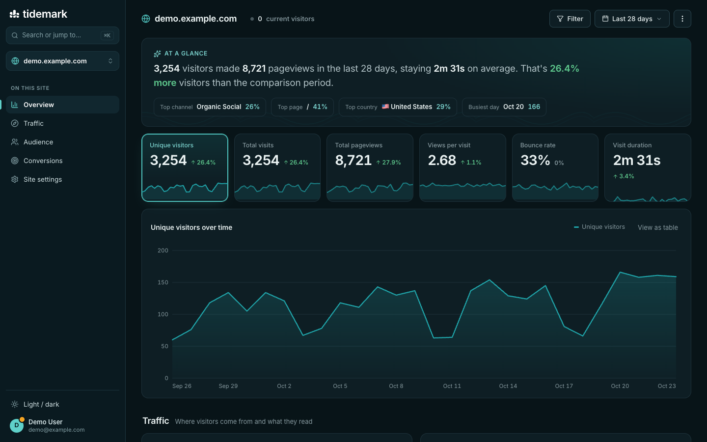
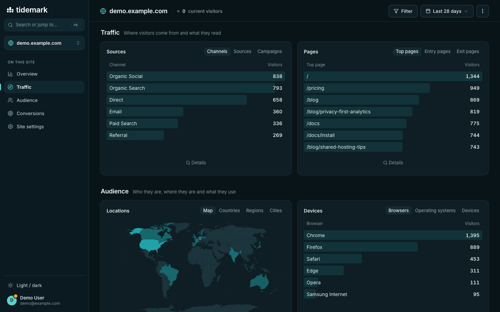
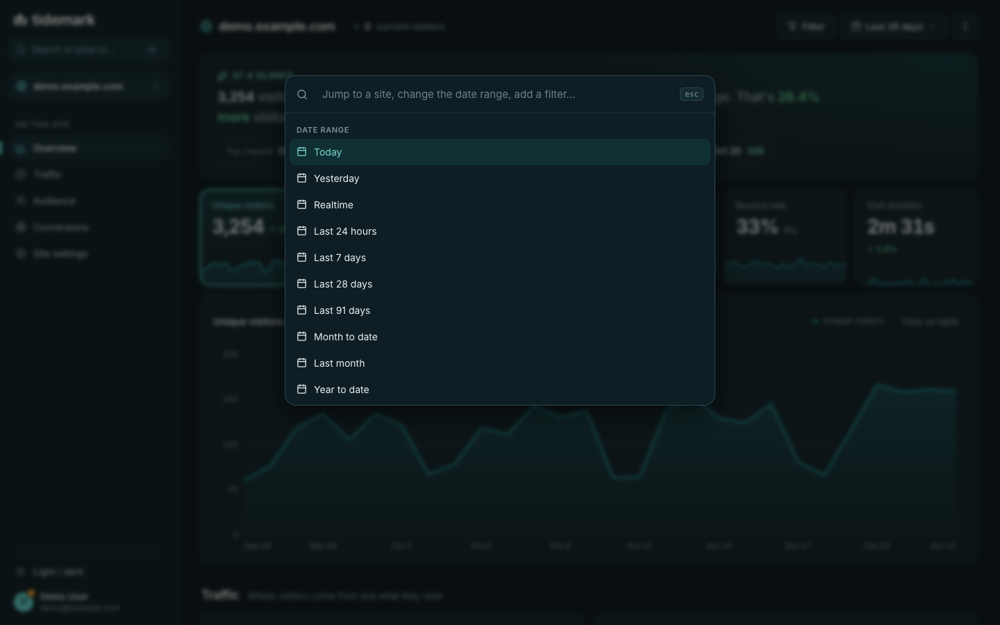
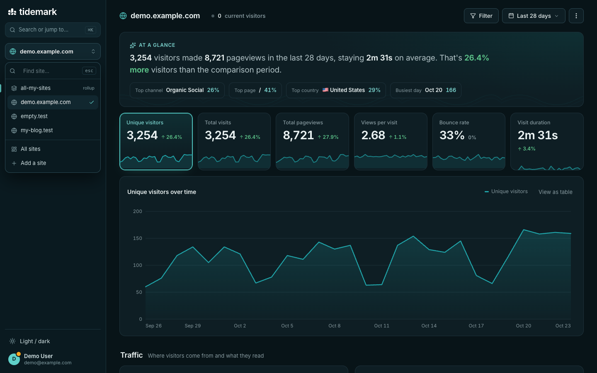
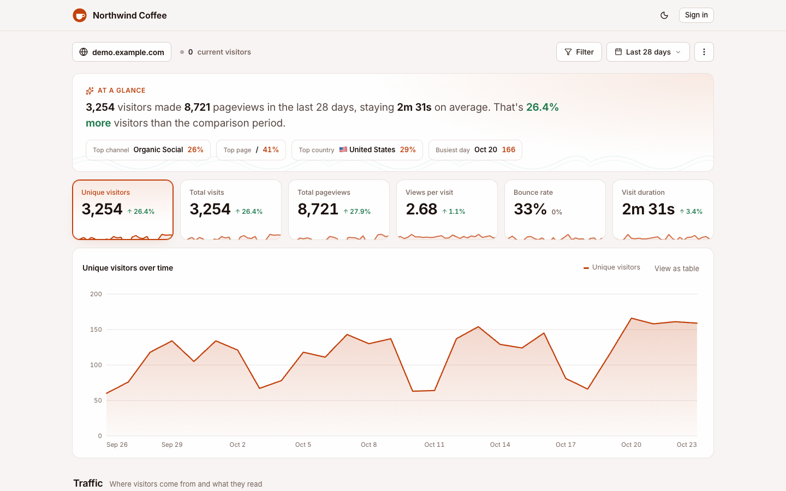

# Tidemark for Unraid

[Community Applications](https://unraid.net/community/apps) template for [Tidemark](https://tidemarkanalytics.com), privacy-first web analytics.

- Image: `ghcr.io/tidemark-analytics/tidemark` (amd64 and arm64)
- Template: [`templates/tidemark.xml`](templates/tidemark.xml)
- Guide: [Install with Docker](https://docs.tidemarkanalytics.com/article/137-install-with-docker)
- Issues: [tidemark-analytics/tidemark](https://github.com/tidemark-analytics/tidemark/issues)

## Install

Search for **Tidemark** in Apps. Set **Public address** to where you'll reach it, apply, open the WebUI and go to `/install` to create your admin account. Put it behind a reverse proxy for HTTPS.

## Updating

Update the container from the Docker tab. Database migrations run the first time you open the dashboard afterwards.

## Screenshots

Licensed under the MIT license.
